# TÀI LIỆU PHÂN TÍCH VÀ THIẾT KẾ HƯỚNG ĐỐI TƯỢNG (OOAD)
## ĐỒ ÁN: HỆ THỐNG QUẢN LÝ VẬN HÀNH VÀ ĐẶT VÉ RẠP PHIM

---

## MỤC LỤC
1. [Tổng quan hệ thống & Actors](#1-tổng-quan-hệ-thống--actors)
2. [Use Case Diagram](#2-use-case-diagram)
3. [Activity Diagrams](#3-activity-diagrams)
   - 3.1. Đặt vé xem phim
   - 3.2. Chọn và Giữ ghế tạm thời (10 phút)
   - 3.3. Thanh toán đơn hàng & Xuất vé
   - 3.4. Báo cáo sự cố rạp chiếu
   - 3.5. Xử lý & Khắc phục sự cố kỹ thuật
   - 3.6. Lập kế hoạch & Thực hiện bảo trì thiết bị
   - 3.7. Kiểm tra phòng chiếu (Daily Checklist)
   - 3.8. Lập lịch chiếu phim (Kiểm tra xung đột)
4. [Sequence Diagrams](#4-sequence-diagrams)
   - 4.1. Đăng nhập & Xác thực JWT
   - 4.2. Đặt vé & Giữ ghế đồng thời (Chống trùng ghế)
   - 4.3. Giải phóng ghế tự động sau 10 phút (Hold Timeout)
   - 4.4. Thanh toán & Khởi tạo vé điện tử
   - 4.5. Nhân viên báo cáo sự cố phòng chiếu
   - 4.6. Quản lý phân công sự cố cho Kỹ thuật viên
   - 4.7. Kỹ thuật viên xử lý sự cố và ghi nhận chi phí
   - 4.8. Kế hoạch bảo trì thiết bị định kỳ
   - 4.9. Lập lịch chiếu với kiểm tra ràng buộc phòng & thiết bị
5. [Class Diagram](#5-class-diagram)
6. [Business Rules (Quy tắc nghiệp vụ cốt lõi)](#6-business-rules)
7. [Định hướng mở rộng & Phát triển tương lai (Future Roadmap)](#7-định-hướng-mở-rộng--phát-triển-tương-lai)

---

## 1. TỔNG QUAN HỆ THỐNG & ACTORS

Hệ thống có 5 Actor chính:
- **Khách hàng (Customer):** Đăng ký/đăng nhập, duyệt danh mục phim, tra cứu lịch chiếu, chọn ghế theo thời gian thực, giữ ghế 10 phút, thanh toán trực tuyến, quản lý vé và yêu cầu hủy vé/gửi phản hồi.
- **Quản trị viên (Admin):** Toàn quyền quản trị hệ thống (Người dùng, Phân quyền Role, Phim, Phòng, Thiết bị, Lịch chiếu, Báo cáo tài chính, Cấu hình).
- **Quản lý rạp (Manager):** Quản lý lịch chiếu, theo dõi tình trạng phòng chiếu/thiết bị, tiếp nhận sự cố, phân công nhân viên & kỹ thuật viên, theo dõi bảo trì, duyệt doanh thu và báo cáo.
- **Nhân viên vận hành (Staff):** Xem ca làm việc, thực hiện checklist kiểm tra 9 hạng mục phòng chiếu, phát hiện & tạo báo cáo sự cố, soát vé và hỗ trợ khách hàng.
- **Kỹ thuật viên (Technician):** Tiếp nhận sự cố & kế hoạch bảo trì được phân công, khảo sát nguyên nhân, cập nhật phương án sửa chữa, chi phí, linh kiện thay thế và nghiệm thu thiết bị.

---

## 2. USE CASE DIAGRAM

```mermaid
flowchart TB
    %% Actors
    subgraph Actors [TÁC NHÂN HỆ THỐNG]
        Customer["👤 Khách Hàng (Customer)"]
        Staff["👔 Nhân Viên (Staff)"]
        Tech["🔧 Kỹ Thuật Viên (Technician)"]
        Manager["💼 Quản Lý Rạp (Manager)"]
        Admin["👑 Quản Trị Viên (Admin)"]
    end

    %% Use Cases
    subgraph CinemaSystem ["HỆ THỐNG QUẢN LÝ VẬN HÀNH & ĐẶT VÉ RẠP PHIM"]
        %% Module Auth
        UC_Auth([Đăng nhập / Đăng ký / Xác thực JWT])
        
        %% Module Khách hàng
        UC_ViewMovies([Xem thông tin phim & Lịch chiếu])
        UC_HoldSeat([Chọn & Giữ ghế 10 phút])
        UC_Pay([Thanh toán đơn hàng])
        UC_MyTickets([Xem & Quản lý vé của tôi])
        UC_Feedback([Gửi phản hồi & Hỗ trợ])
        
        %% Module Vận hành & Kỹ thuật
        UC_Checklist([Kiểm tra phòng chiếu 9 tiêu chí])
        UC_ReportIncident([Báo cáo sự cố phòng/thiết bị])
        UC_AssignTask([Phân công sự cố & Bảo trì])
        UC_ResolveIncident([Tiếp nhận & Xử lý sự cố])
        UC_Maintenance([Thực hiện bảo trì thiết bị])
        
        %% Module Quản lý rạp
        UC_ManageSchedule([Lập lịch chiếu & Check xung đột])
        UC_ManageRoom([Quản lý phòng chiếu & Ghế])
        UC_ManageEquip([Quản lý thiết bị rạp])
        UC_ManageShift([Quản lý ca làm việc & Nhân sự])
        UC_Dashboard([Xem Dashboard & Thống kê doanh thu])
        
        %% Module Admin
        UC_ManageUser([Quản lý tài khoản & Phân quyền])
        UC_SystemConfig([Cấu hình hệ thống])
    end

    %% Connections
    Customer --> UC_Auth
    Customer --> UC_ViewMovies
    Customer --> UC_HoldSeat
    Customer --> UC_Pay
    Customer --> UC_MyTickets
    Customer --> UC_Feedback

    Staff --> UC_Auth
    Staff --> UC_Checklist
    Staff --> UC_ReportIncident
    Staff --> UC_MyTickets

    Tech --> UC_Auth
    Tech --> UC_ResolveIncident
    Tech --> UC_Maintenance

    Manager --> UC_Auth
    Manager --> UC_ManageSchedule
    Manager --> UC_ManageRoom
    Manager --> UC_ManageEquip
    Manager --> UC_AssignTask
    Manager --> UC_ManageShift
    Manager --> UC_Dashboard

    Admin --> UC_Auth
    Admin --> UC_ManageUser
    Admin --> UC_SystemConfig
    Admin --> UC_Dashboard
    Admin --> UC_ManageRoom
    Admin --> UC_ManageSchedule
```

---

## 3. ACTIVITY DIAGRAMS

### 3.1. Đặt vé xem phim
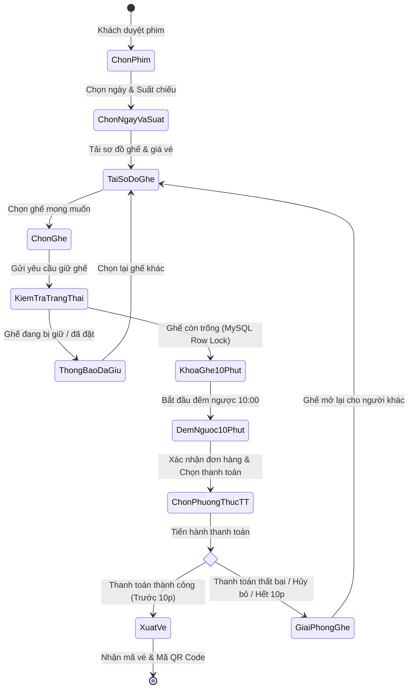

### 3.2. Chọn và Giữ ghế tạm thời (10 phút)
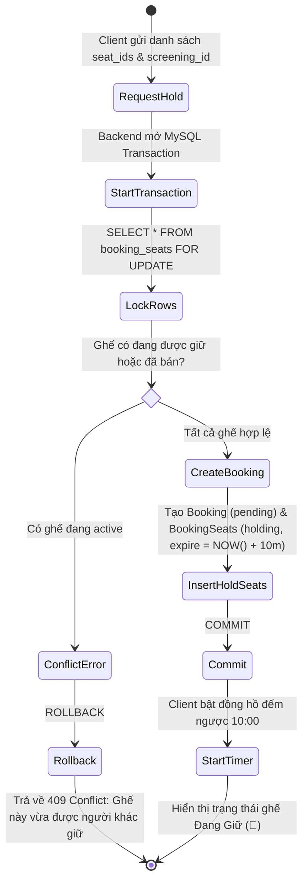

### 3.3. Thanh toán đơn hàng & Xuất vé
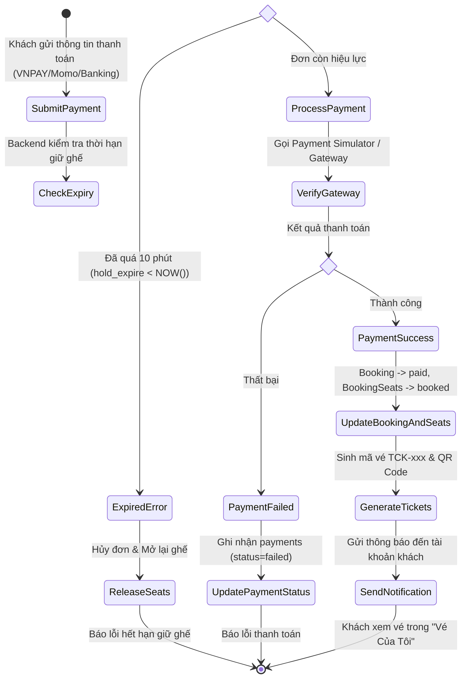

### 3.4. Báo cáo sự cố rạp chiếu (Incident Reporting)
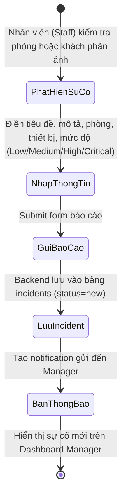

### 3.5. Xử lý & Khắc phục sự cố kỹ thuật
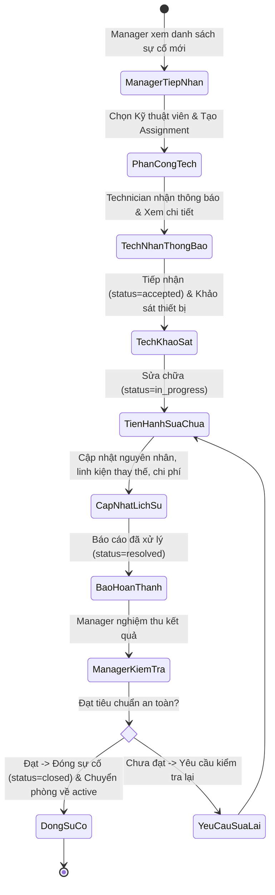

### 3.6. Lập kế hoạch & Thực hiện bảo trì thiết bị
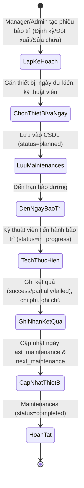

### 3.7. Kiểm tra phòng chiếu (Daily Checklist)
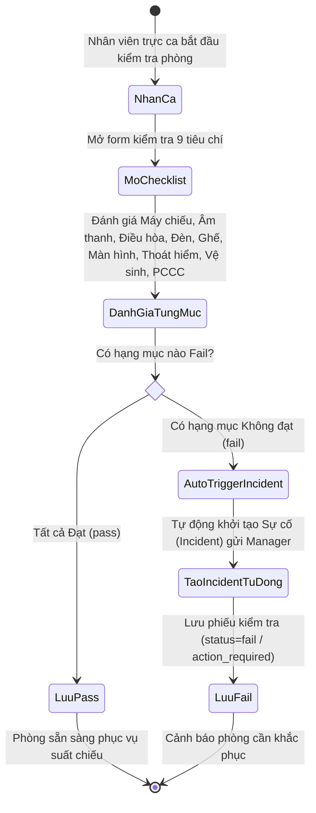

### 3.8. Lập lịch chiếu phim (Kiểm tra xung đột)
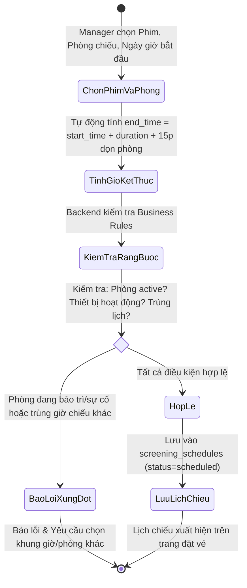

---

## 4. SEQUENCE DIAGRAMS

### 4.1. Đăng nhập & Xác thực JWT
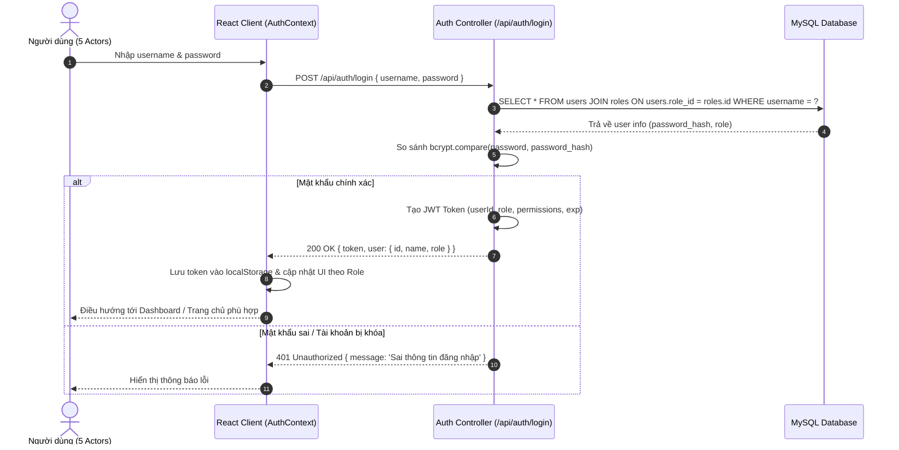

### 4.2. Đặt vé & Giữ ghế đồng thời (Chống trùng ghế Concurrency)
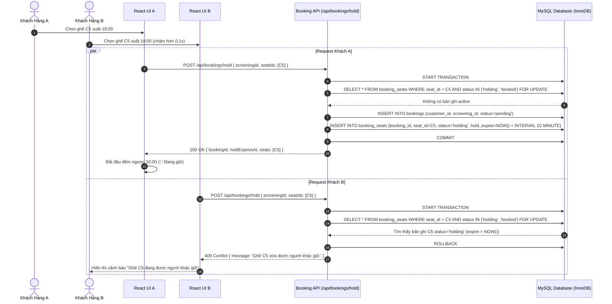

### 4.3. Giải phóng ghế tự động sau 10 phút (Hold Timeout)
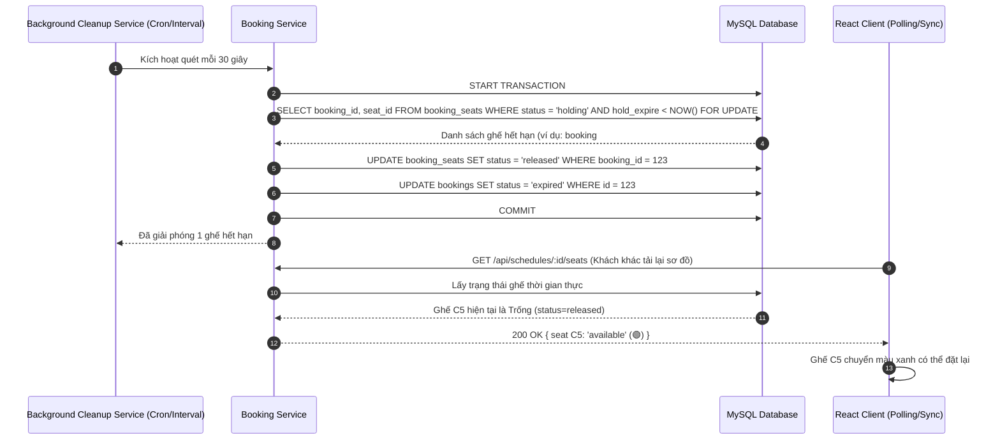

### 4.4. Thanh toán & Khởi tạo vé điện tử
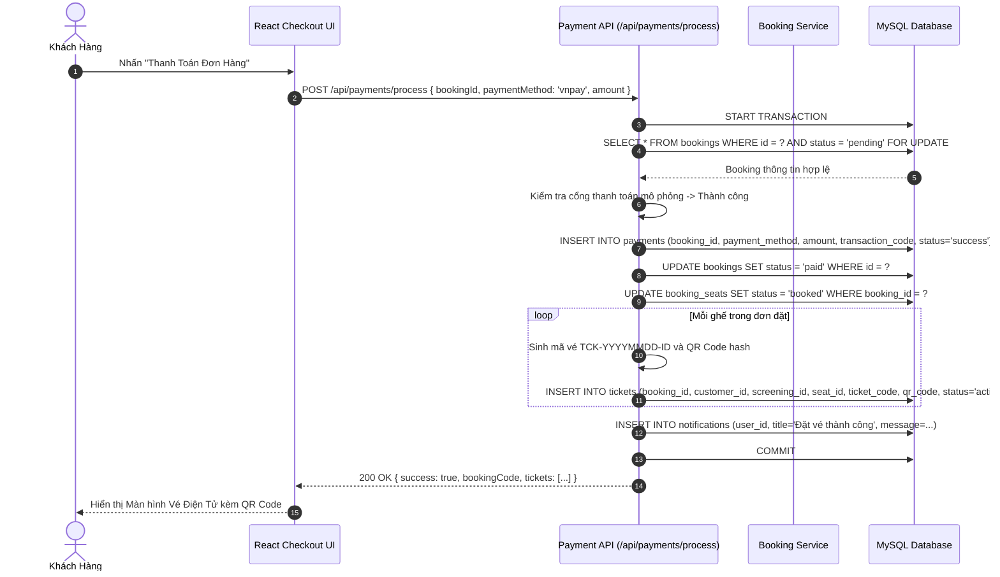

### 4.5. Nhân viên báo cáo sự cố phòng chiếu
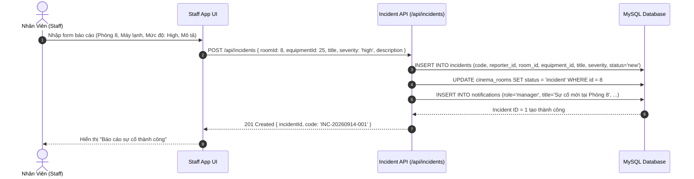

### 4.6. Quản lý phân công sự cố cho Kỹ thuật viên
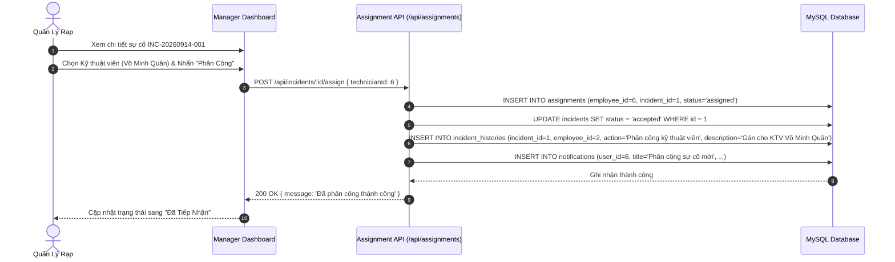

### 4.7. Kỹ thuật viên xử lý sự cố và ghi nhận chi phí
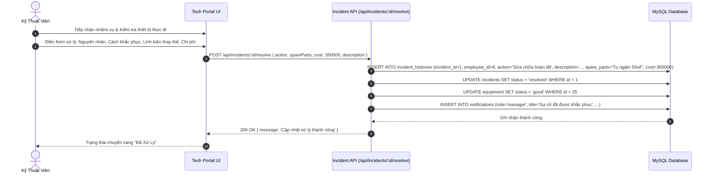

### 4.8. Kế hoạch bảo trì thiết bị định kỳ
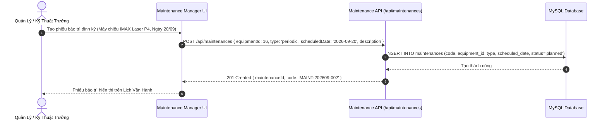

### 4.9. Lập lịch chiếu với kiểm tra ràng buộc phòng & thiết bị
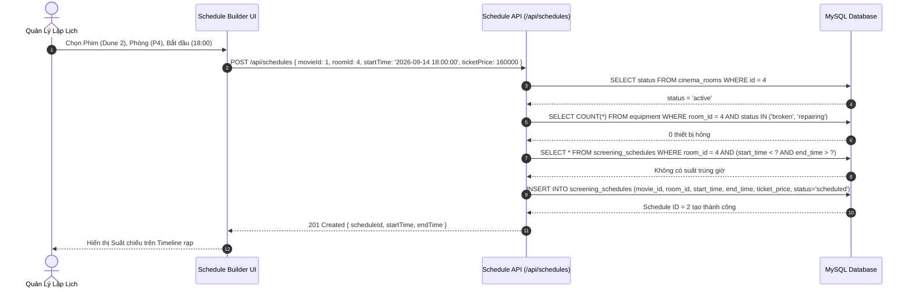

---

## 5. CLASS DIAGRAM

```mermaid
classDiagram
    %% Core Users & Roles
    class User {
        +int id
        +string username
        +string password
        +int roleId
        +string status
        +DateTime createdAt
        +login(password) bool
        +changePassword(newPass) void
    }

    class Role {
        +int id
        +string name
        +string description
        +hasPermission(perm) bool
    }

    class Customer {
        +int id
        +int userId
        +string name
        +string email
        +string phone
        +string membershipLevel
        +DateTime createdAt
        +getBookingHistory() List~Booking~
    }

    class Employee {
        +int id
        +int userId
        +string name
        +string phone
        +string email
        +string position
        +string department
        +string status
        +getAssignedTasks() List~Assignment~
    }

    %% Movies & Cinema Infrastructure
    class Movie {
        +int id
        +string name
        +string genre
        +string director
        +string actors
        +int duration
        +Date releaseDate
        +Date endDate
        +string ageRating
        +string language
        +string format
        +string description
        +string poster
        +string trailer
        +string status
        +getSchedules(date) List~ScreeningSchedule~
    }

    class CinemaRoom {
        +int id
        +string name
        +string roomType
        +int capacity
        +string location
        +string status
        +string description
        +isAvailableForSchedule(startTime, endTime) bool
        +getSeats() List~Seat~
    }

    class Seat {
        +int id
        +int roomId
        +string rowNumber
        +int seatNumber
        +string seatType
        +string status
        +getSeatLabel() string
    }

    class ScreeningSchedule {
        +int id
        +int movieId
        +int roomId
        +DateTime startTime
        +DateTime endTime
        +string format
        +decimal ticketPrice
        +string status
        +getSeatStatusMap() Map
        +checkConflict() bool
    }

    %% Booking & Payment
    class Booking {
        +int id
        +int customerId
        +int screeningId
        +string bookingCode
        +DateTime bookingTime
        +decimal totalAmount
        +string status
        +calculateTotal() decimal
        +confirmPayment() bool
        +cancel() void
    }

    class BookingSeat {
        +int id
        +int bookingId
        +int seatId
        +decimal price
        +string status
        +DateTime holdStart
        +DateTime holdExpire
        +isExpired() bool
        +release() void
    }

    class Payment {
        +int id
        +int bookingId
        +string paymentMethod
        +decimal amount
        +string transactionCode
        +DateTime paymentTime
        +string status
        +process() bool
        +refund() bool
    }

    class Ticket {
        +int id
        +int bookingId
        +int customerId
        +int screeningId
        +int seatId
        +string ticketCode
        +string qrCode
        +string status
        +verify() bool
        +cancel() bool
    }

    %% Equipment & Operations
    class EquipmentType {
        +int id
        +string name
        +string description
    }

    class Equipment {
        +int id
        +int equipmentTypeId
        +int roomId
        +string name
        +string code
        +string manufacturer
        +Date purchaseDate
        +Date warrantyEnd
        +Date lastMaintenance
        +Date nextMaintenance
        +string status
        +checkHealth() string
    }

    class Incident {
        +int id
        +string code
        +int reporterId
        +int roomId
        +int equipmentId
        +string title
        +string description
        +string severity
        +string status
        +DateTime createdAt
        +assign(technicianId) void
        +resolve(solution, cost) void
        +close() void
    }

    class IncidentHistory {
        +int id
        +int incidentId
        +int employeeId
        +string action
        +string description
        +string spareParts
        +decimal cost
        +DateTime createdAt
    }

    class Maintenance {
        +int id
        +string code
        +int equipmentId
        +int employeeId
        +string type
        +string description
        +Date scheduledDate
        +Date completedDate
        +string result
        +decimal cost
        +string note
        +string status
        +complete(result, cost) void
    }

    class WorkShift {
        +int id
        +int employeeId
        +Date workDate
        +string shiftName
        +Time startTime
        +Time endTime
        +string position
        +int roomId
        +string status
        +checkIn() void
    }

    class Assignment {
        +int id
        +int employeeId
        +int incidentId
        +int maintenanceId
        +DateTime assignedAt
        +string status
        +accept() void
    }

    class RoomInspection {
        +int id
        +int roomId
        +int employeeId
        +DateTime inspectionDate
        +string status
        +string note
        +submitChecklist(details) void
    }

    class InspectionDetail {
        +int id
        +int inspectionId
        +string itemName
        +string status
        +string note
    }

    class Notification {
        +int id
        +int userId
        +string title
        +string message
        +string type
        +bool isRead
        +DateTime createdAt
        +markAsRead() void
    }

    %% Relationships
    User "1" <-- "1" Role : has role
    User "1" <-- "0..1" Customer : profile
    User "1" <-- "0..1" Employee : profile
    User "1" --> "*" Notification : receives

    CinemaRoom "1" *-- "*" Seat : contains
    CinemaRoom "1" --> "*" ScreeningSchedule : hosts
    CinemaRoom "1" o-- "*" Equipment : contains

    Movie "1" --> "*" ScreeningSchedule : scheduled in
    ScreeningSchedule "1" --> "*" Booking : creates
    Customer "1" --> "*" Booking : places

    Booking "1" *-- "1..*" BookingSeat : reserves
    Seat "1" <-- "1" BookingSeat : refers to
    Booking "1" -- "1" Payment : paid by
    Booking "1" *-- "1..*" Ticket : produces

    EquipmentType "1" <-- "*" Equipment : categorizes
    Equipment "1" --> "*" Incident : suffers from
    Equipment "1" --> "*" Maintenance : undergoes

    Incident "1" *-- "*" IncidentHistory : tracks
    Employee "1" --> "*" Incident : reported by
    Employee "1" --> "*" Assignment : assigned to
    Incident "1" o-- "*" Assignment : includes
    Maintenance "1" o-- "*" Assignment : includes

    Employee "1" --> "*" WorkShift : works in
    CinemaRoom "1" <-- "*" WorkShift : assigned room

    CinemaRoom "1" <-- "*" RoomInspection : inspected for
    Employee "1" --> "*" RoomInspection : inspected by
    RoomInspection "1" *-- "9" InspectionDetail : comprises
```

---

## 6. BUSINESS RULES (QUY TẮC NGHIỆP VỤ)

| Mã Quy Tắc | Tên Quy Tắc | Mô Tả Chi Tiết |
|---|---|---|
| **BR01** | Tránh xung đột lịch chiếu | Một phòng chiếu không được phép tồn tại 2 suất chiếu trùng nhau hoặc cách nhau dưới 15 phút dọn phòng. |
| **BR02** | Ràng buộc phòng chiếu | Không thể tạo lịch chiếu mới cho phòng đang trong trạng thái `maintenance` hoặc `incident`. |
| **BR03** | Ràng buộc thiết bị trọng yếu | Không mở bán vé hoặc chiếu phim nếu máy chiếu (`Projector`) hoặc âm thanh (`Sound System`) của phòng đang hỏng. |
| **BR04** | Độc quyền ghế trong suất chiếu | Một ghế chỉ được đặt hoặc giữ duy nhất 1 lần trong cùng 1 suất chiếu (`screening_schedule + seat`). |
| **BR05** | Khóa ghế đang giữ | Khi khách hàng chọn ghế, ghế lập tức chuyển sang trạng thái 🔵 `holding` và bị khóa với toàn bộ khách hàng khác. |
| **BR06** | Thời hạn giữ ghế 10 phút | Cơ chế giữ ghế mặc định kéo dài đúng 10 phút kể từ thời điểm `hold_start`. |
| **BR07** | Tự động giải phóng ghế | Hết 10 phút mà đơn hàng chưa thanh toán, backend tự động chuyển trạng thái ghế sang `released` và hủy `booking`. |
| **BR08** | Chuyển trạng thái khi thanh toán | Khi thanh toán thành công, ghế lập tức chuyển từ 🔵 `holding` sang 🔴 `booked` và sinh mã vé điện tử. |
| **BR09** | Xử lý thanh toán thất bại | Nếu khách hủy thanh toán hoặc thanh toán lỗi, ghế được mở lại trạng thái 🟢 `available` ngay lập tức. |
| **BR10** | Backend Concurrency Locking | Backend bắt buộc sử dụng MySQL Transaction & Row-Level Locking (`SELECT FOR UPDATE`) để ngăn Race Condition khi 2 khách cùng bấm chọn ghế cùng mili-giây. |
| **BR11** | Chặn đặt suất đã qua | Không cho phép đặt vé hoặc giữ ghế đối với suất chiếu có `start_time` trong quá khứ. |
| **BR12** | Phân quyền Kỹ thuật viên | Kỹ thuật viên chỉ có thể cập nhật kết quả xử lý đối với các sự cố/bảo trì được phân công cho mình. |
| **BR13** | Tính toàn vẹn sự cố đã đóng | Sự cố đã được chuyển sang `closed` sẽ bị khóa và không thể chỉnh sửa nội dung. |
| **BR14** | Thẩm quyền đóng sự cố | Chỉ có Manager hoặc Admin mới có quyền nghiệm thu và chuyển sự cố sang trạng thái `closed`. |
| **BR15** | Lưu vết lịch sử bảo trì & sự cố | Toàn bộ các thao tác thay đổi linh kiện, chi phí, giải pháp xử lý bắt buộc phải ghi log vào `incident_histories`. |
| **BR16** | Checklist kích hoạt sự cố tự động | Trong quá trình kiểm tra phòng 9 tiêu chí, nếu có bất kỳ hạng mục nào bị đánh dấu `fail`, hệ thống tự động sinh 1 bản ghi `incidents` tương ứng. |

---

## 7. ĐỊNH HƯỚNG MỞ RỘNG & PHÁT TRIỂN TƯƠNG LAI (FUTURE ROADMAP)

Dựa trên nền tảng kiến trúc vững chắc hiện tại của đồ án OOAD (đã hoàn thiện 22 lớp thực thể, phân quyền 5 Actors RBAC, giao dịch MySQL InnoDB Row-level Lock), hệ thống định hướng mở rộng thành một hệ sinh thái rạp chiếu phim thế hệ mới theo 5 trụ cột chiến lược:

### 7.1. Phân Hệ Trải Nghiệm Khách Hàng (Customer Experience 4.0)
1. **Sơ đồ ghế 3D góc nhìn thực tế (3D Seat View Simulation):**
   * Sử dụng thư viện WebGL / Three.js để mô phỏng không gian khán phòng 3D.
   * Khách hàng có thể nhấn vào từng ghế (Standard, VIP, Sweetbox) để "nhìn thử" góc nhìn thực tế tới màn chiếu, kiểm tra độ dốc và loại trừ các góc khuất.
2. **Đặt trước Combo Bắp Nước (F&B Express Fast-Track):**
   * Tích hợp giỏ hàng chọn bắp, nước, snack ngay sau bước chọn ghế.
   * Sinh mã QR nhận F&B riêng biệt; khi đến rạp, khách hàng đi vào luồng nhận nhanh "Fast Track" để nhận phần ăn mà không phải xếp hàng thanh toán.
3. **Vé động chống gian lận & Hỗ trợ Apple/Google Wallet:**
   * Tích hợp lưu thẻ vé xem phim trực tiếp vào Apple Wallet / Google Wallet.
   * Mã QR động (Dynamic QR / TOTP) làm mới mỗi 30 giây để ngăn chặn tình trạng chụp ảnh màn hình bán lại vé lậu.
4. **Chia tiền vé nhóm (Split-Bill & Group Booking):**
   * Một người đại diện giữ một cụm ghế và tạo link chia tiền; các thành viên trong nhóm có thời gian quy định (10–15 phút) để thanh toán phần ghế của mình.

### 7.2. Phân Hệ Tối Ưu Doanh Thu & Giá Động (Dynamic Pricing Engine)
1. **Thuật toán định giá động (Dynamic Pricing):**
   * Tự động điều chỉnh giá vé dựa trên nhu cầu thời gian thực: Tăng giá vé vào khung giờ cao điểm (tối thứ 6, cuối tuần), các vị trí ghế trung tâm đẹp của phim bom tấn; đồng thời tự động giảm giá sâu các suất sáng sớm/khuya muộn để kích cầu và tối ưu tỷ lệ lấp đầy phòng chiếu.
2. **Gói thành viên Cinema Pass (Subscription Model):**
   * Cung cấp gói thuê bao xem phim cố định theo tháng (tương tự AMC Stubs A-List), tích điểm đổi quà và các ưu đãi thành viên hạng VIP, Diamond.

### 7.3. Phân Hệ Vận Hành Thông Minh & Tự Động Hóa IoT (Smart Cinema & IoT)
1. **Tự động hóa phòng chiếu Green Cinema:**
   * Tích hợp bộ điều khiển phần cứng IoT (MQTT / Zigbee): Tự động bật máy lạnh phòng chiếu trước giờ phim 15 phút, tự động làm mờ đèn khán phòng khi phim bắt đầu chiếu và bật sáng đèn dọn dẹp khi hết phần credit.
   * Tự động tắt toàn bộ thiết bị phòng chiếu khi không có lịch chiếu kế tiếp, tiết kiệm tới 25% điện năng tiêu thụ.
2. **Bảo trì dự đoán (Predictive Maintenance):**
   * Lũy kế số giờ hoạt động thực tế của bóng đèn máy chiếu Laser, động cơ máy lạnh và màng loa âm thanh.
   * Đưa ra cảnh báo chủ động cho Kỹ thuật viên khi linh kiện đạt 80%–90% tuổi thọ khuyến nghị, ngăn ngừa sự cố gián đoạn suất chiếu.
3. **Bảng hiển thị số sảnh chờ (Digital Signage Real-time):**
   * Đồng bộ dữ liệu qua WebSocket: Màn hình lớn tại sảnh rạp tự động hiển thị tình trạng vé các suất sắp chiếu, quầy gọi số nhận bắp nước theo thời gian thực.

### 7.4. Phân Hệ Ứng Dụng AI & Xử Lý Ngôn Ngữ Tự Nhiên
1. **Trợ lý AI tư vấn phim (AI Movie Concierge):**
   * Chatbot AI tích hợp mô hình ngôn ngữ lớn (LLM): Hiểu câu hỏi tự nhiên của khách (*"Tìm giúp mình phim kinh dị hoặc trinh thám chiếu sau 20h tối nay cho 2 người ở phòng IMAX"*) và tự động gợi ý suất chiếu + chuyển thẳng sang màn hình chọn ghế.
2. **Hệ thống gợi ý phim cá nhân hóa (Recommendation Engine):**
   * Ứng dụng giải thuật lọc cộng tác (Collaborative Filtering) và lọc dựa trên nội dung (Content-based Filtering) dựa trên lịch sử mua vé và diễn viên/đạo diễn yêu thích của khách hàng.
3. **Phân tích cảm xúc phản hồi (Review Sentiment Analysis):**
   * Tự động quét và phân loại mức độ hài lòng của khán giả từ đánh giá văn bản (Positive, Neutral, Negative), giúp ban quản lý nhanh chóng phát hiện các phàn nàn về vệ sinh, máy lạnh hay phục vụ tại rạp.

### 7.5. Thiết Kế Mở Rộng Mô Hình OOAD (Proposed OOAD Extensions)
Để hiện thực hóa các định hướng trên, hệ thống có thể mở rộng thêm các lớp thực thể trong mô hình Class Diagram:
* **Gói F&B:** `FoodItem`, `ComboPackage`, `BookingFoodItem` (kết hợp với `Booking`).
* **Gói Dynamic Pricing:** `DynamicPricingRule`, `PriceModifier` (áp dụng chiến lược *Strategy Pattern* để tính giá linh hoạt).
* **Gói Khách Hàng VIP:** `MembershipTier`, `CinemaPassSubscription`, `RewardPoint`.
* **Gói IoT & Thiết Bị:** `IoTDeviceController`, `EquipmentTelemetryLog` (kế thừa hoặc liên kết với `Equipment`).
* **Gói AI & Đánh Giá:** `MovieRecommendation`, `MovieReview`, `SentimentLog`.
